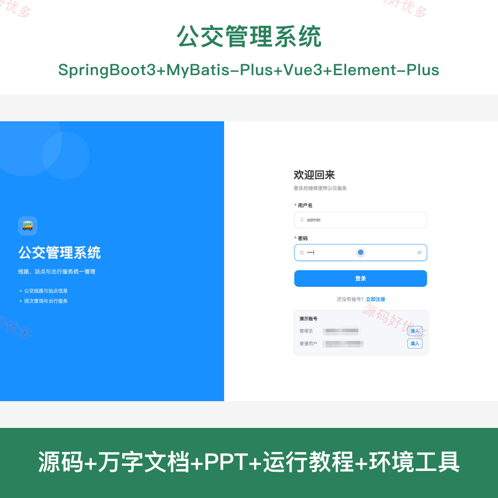
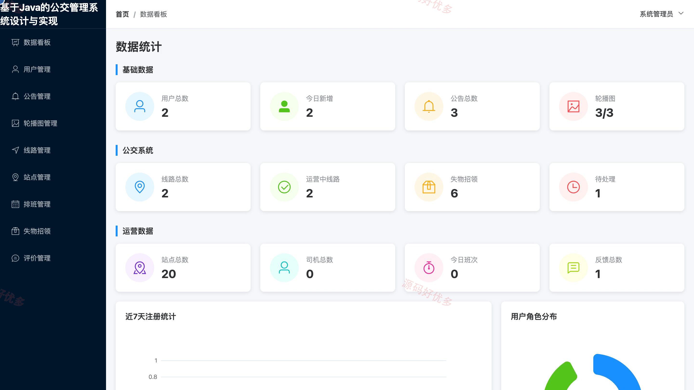
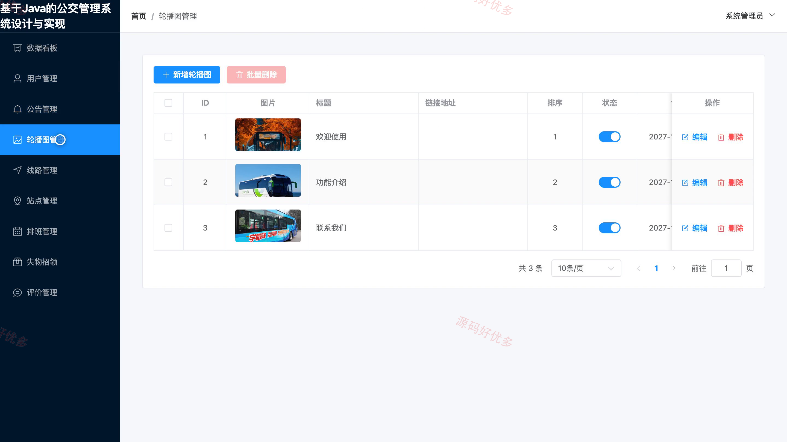
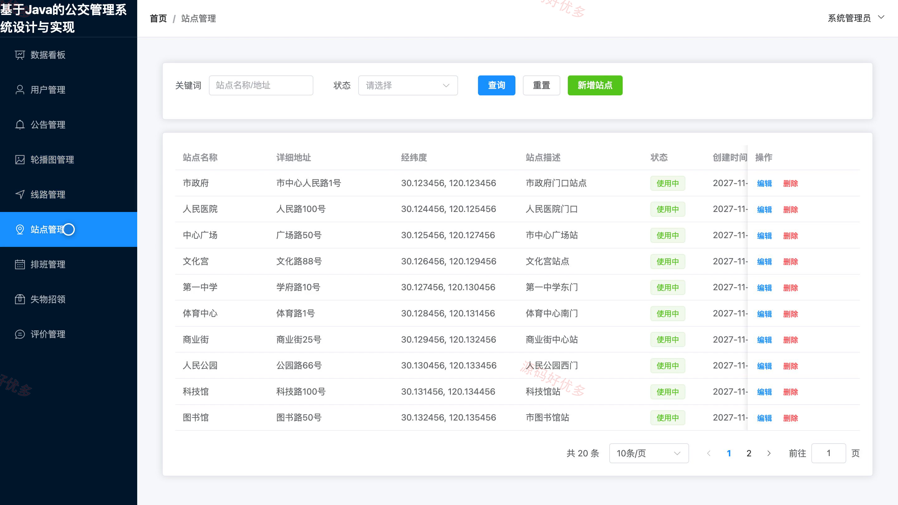

# bs141A
bs141A公交管理系统源码 Java SpringBoot3 Vue3 前后分离 设计文档 PPT
## 源码问题查看主页咨询

### 一、关键词
公交线路查询、班次查询、公交站点、失物招领、乘车评价

### 二、作品包含
源码+数据库+万字设计文档+PPT+全套环境和工具资源+本地部署教程

### 三、项目技术
前端技术： Html、Css、Js、Vue3.4、Element-Plus
后端技术：Java、SpringBoot3.2.0、MyBatis-Plus

### 四、运行环境要求
开发工具：IDEA/eclipse + VSCODE

数据库：MySQL5.7+（共12张表）

数据库管理工具：Navicat10以上版本

环境配置软件： JDK17 + Maven3.6

前端Nodejs：20

浏览器：谷歌浏览器

### 五、项目介绍
项目编号：bs141A

公交管理系统为乘客提供线路、站点和班次查询，以及收藏、失物招领和乘车评价；管理员在后台维护线路、站点、排班、公告及用户资料。

角色：用户、管理员

用户功能：注册与登录、查询公交线路与站点、查询班次安排、收藏常用线路、查看公告、查看与发布失物信息、查看与发布乘车评价、维护个人信息与密码。

管理员功能：查看数据看板、管理用户资料、维护公告与轮播图、管理公交线路、管理站点、管理班次排班、处理失物招领信息、管理乘车评价。

### 六、运行截图

